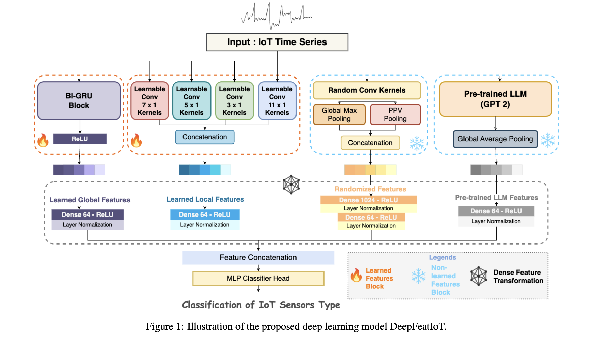
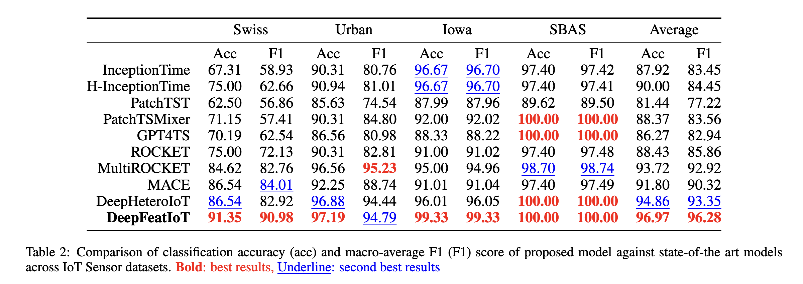

# 📄 DeepFeatIoT: Unifying Deep Learned, Randomized, and LLM Features for Enhanced IoT Time Series Sensor Data Classification in Smart Industries

Official Implementation of *"DeepFeatIoT"* accepted at **IJCAI 2025** under the special track of AI4Tech: AI Enabling Critical Technologies as a full-length original research article after a double blind peer-review process. This year the acceptance rate of full-length research articles were less than 18%. IJCAI is a CORE A* conference and a flagship international research conference in Artificial Intelligence.

[
](https://www.ijcai.org/proceedings/2025/1025.pdf)

---

## 📌 Abstract

*Internet of Things (IoT) sensors are ubiquitous technologies deployed across smart cities, industrial sites, and healthcare systems. They continuously generate time series data that enable advanced analytics and automation in industries. However, challenges such as the loss or ambiguity of sensor metadata, heterogeneity in data sources, varying sampling frequencies, inconsistent units of measurement, and irregular timestamps make raw IoT time series data difficult to interpret, undermining the effectiveness of smart systems. To address these challenges, we propose a novel deep learning model, DeepFeatIoT, which integrates learned local and global features with non-learned randomized convolutional kernel-based features and features from large language models (LLMs). This straightforward yet unique fusion of diverse learned and non-learned features significantly enhances IoT time series sensor data classification, even in scenarios with limited labeled data. Our model's effectiveness is demonstrated through its consistent and generalized performance across multiple real-world IoT sensor datasets from diverse critical application domains, outperforming state-of-the-art benchmark models. These results highlight DeepFeatIoT's potential to drive significant advancements in IoT analytics and support the development of next-generation smart systems.*

---

## 🚀 Overview

We introduce **DeepFeatIoT**, which uniquely integrates: learnable local (multi-scale learnable convolutions) and global feature (bi-directional gated recurrent units) with non-learned randomized convolutional kernel features, and pretrained LLM features to enhance classification performance across various IoT sensor datasets, even in scenarios with limited labeled data. Our approach achieves state-of-the-art performance on heterogenous IoT Time Series Sensor data classification task.

---

## 📂 Repository Overview

```

.
├── datasets/             # Contains datasets
├── scripts/              # Source code
├── paper/                # paper related other resources
├── requirements.txt      # Python dependencies
└── README.md

```

---

## ⚙️ Installation (Ubuntu Linux / MAC)

Clone this repository and install dependencies:

```bash
git clone https://github.com/skinan/DeepFeatIoT-IJCAI-2025.git
cd DeepFeatIoT-IJCAI-2025
```

**Conda environment setup**

```bash
conda create -n deepfeatiot python=3.9.0
conda activate deepfeatiot
pip install -r requirements.txt
```

---

## 🌟 Proposed Method: DeepFeatIoT



---

## 📈 Experimental Results

Main results from the paper:


---

## 📝 Citation

If you use this code or any resources of the paper (including datasets), please kindly cite our paper:

```bibtex
@inproceedings{ijcai2025p1025,
  title     = {DeepFeatIoT: Unifying Deep Learned, Randomized, and LLM Features for Enhanced IoT Time Series Sensor Data Classification in Smart Industries},
  author    = {Inan, Muhammad Sakib Khan and Liao, Kewen},
  booktitle = {Proceedings of the Thirty-Fourth International Joint Conference on
               Artificial Intelligence, {IJCAI-25}},
  publisher = {International Joint Conferences on Artificial Intelligence Organization},
  editor    = {James Kwok},
  pages     = {9223--9231},
  year      = {2025},
  month     = {8},
  note      = {AI4Tech: AI Enabling Technologies},
  doi       = {10.24963/ijcai.2025/1025},
  url       = {https://doi.org/10.24963/ijcai.2025/1025},
}
```

## ䷉ Extra

This repository also contains the **[DeepHeteroIoT](https://link.springer.com/chapter/10.1007/978-3-031-63989-0_6)** model, published in MobiQuituous 2023. The DeepHeteroIot model code could found in the `"scripts/models"` directory. Please, kindly cite the DeepHeteroIoT paper, if you use Iowa dataset or DeepHeteroIoT model:

```bibtex
@inproceedings{inan2023deepheteroiot,
  title={DeepHeteroIoT: Deep Local and Global Learning over Heterogeneous IoT Sensor Data},
  author={Inan, Muhammad Sakib Khan and Liao, Kewen and Shen, Haifeng and Jayaraman, Prem Prakash and Georgakopoulos, Dimitrios and Tang, Ming Jian},
  booktitle={International Conference on Mobile and Ubiquitous Systems: Computing, Networking, and Services},
  pages={119--135},
  year={2023},
  organization={Springer Nature Switzerland}
}
```
